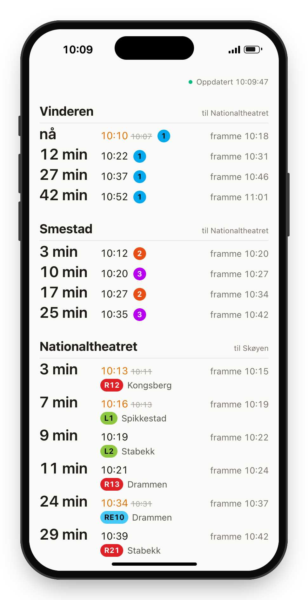
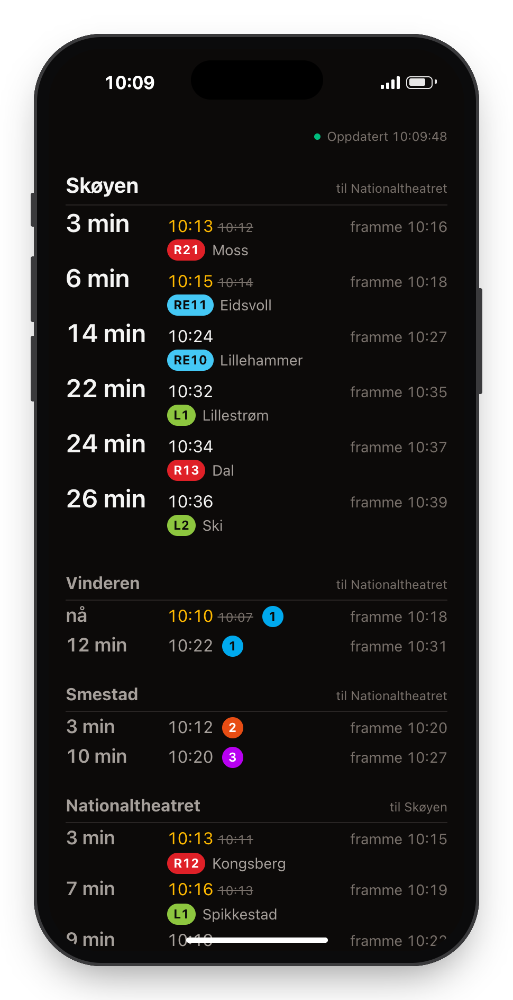

# bgs

A tiny departure board for a daily commute in Oslo. Open it and the next departures are already
there – no searching, no tapping.

<p align="center">
  
  &nbsp;&nbsp;
  
</p>

- A few configured stops, each showing only departures that go to its **destination** – with
  the time you'll **arrive** there, so you can tell which station is actually faster. Chain them
  for a trip with a change: metro into town, then the train on from there.
- Two places, **home** and **work**. The one you're near (within 1.5 km) goes first; without a
  position the clock decides (before 12:00 home, after that work). The position never leaves
  the phone.
- Live data from [Entur](https://developer.entur.org/), refreshed every 20 seconds and whenever
  the app is reopened. Delays, cancellations and fixed line colours included.
- A static PWA on Cloudflare Workers: no server code, no database, no login. Add it to the
  home screen and it opens instantly from cache.

The UI is in Norwegian. The screenshots use the example config.

## Configuration

Your stops are never committed. The build reads the config from, in order:

1. `BGS_CONFIG` – the JSON itself, as an environment variable (a build variable in Cloudflare)
2. `BGS_CONFIG_FILE` – a path to a JSON file
3. `config.local.json` – your own file, ignored by git
4. `config.example.json`

```jsonc
{
  "stops": [
    { "name": "Vinderen", "stopId": "NSR:StopPlace:58270", "mode": "metro", "group": "home",
      "to": { "name": "Nationaltheatret", "stopId": "NSR:StopPlace:58404" } },
    { "name": "Skøyen", "stopId": "NSR:StopPlace:59651", "mode": "rail", "group": "work",
      "to": { "name": "Nationaltheatret", "stopId": "NSR:StopPlace:58404" },
      "excludeAuthorities": ["FLT:Authority:FLT"] }            // optional: leave out Flytoget
  ],
  "places": [                                                  // only used to pick the order
    { "group": "home", "lat": 59.9399, "lon": 10.6943 },
    { "group": "work", "lat": 59.9224, "lon": 10.6785 }
  ],
  "radiusKm": 1.5                                              // optional
}
```

Find stop place ids with Entur's geocoder, e.g.
`https://api.entur.io/geocoder/v1/autocomplete?text=Skøyen&layers=venue`. `mode` is `metro` or
`rail`; `group` is `home` or `work`; `to` is where you're going from that stop. See `config.example.json` and `src/config-schema.ts`.

## Local development

Requires Node 22.22+ (`nvm use` picks Node 24 from `.nvmrc`).

```sh
npm install
cp config.example.json config.local.json   # then put in your own stops
npm run dev                                # http://localhost:5173
npm test
```

- `npm run screenshots` – rebuilds with the example config and renders `docs/screenshots/` in a
  phone frame (needs Google Chrome).
- `npm run icons` – redraws the app icons (needs Python with Pillow).

## Deploy

Every push to `main` is built and deployed by
[Cloudflare Workers Builds](https://developers.cloudflare.com/workers/ci-cd/builds/):

- Build command `npm run build`, deploy command `npx wrangler deploy`.
- Add your config as the build variable `BGS_CONFIG` (Settings → Build → Variables and secrets).
  Without it the build stops rather than deploying the example stops.

To deploy from your own machine (uses `config.local.json`): `npm run deploy`.

## Data and licence

Departure data from [Entur](https://developer.entur.org/) under the
[Norwegian Licence for Open Government Data (NLOD)](https://data.norge.no/nlod/en/2.0).
The code is MIT licensed (see `LICENSE`).
